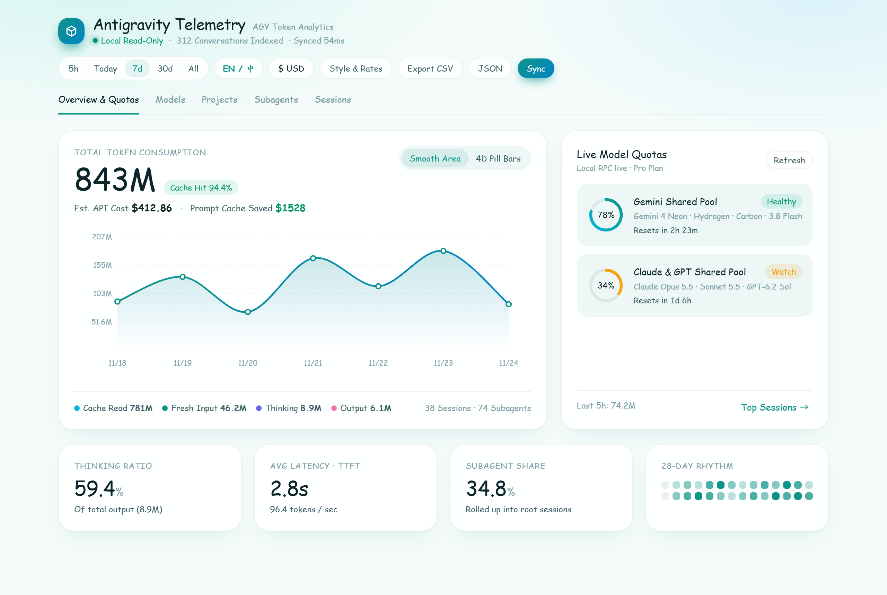
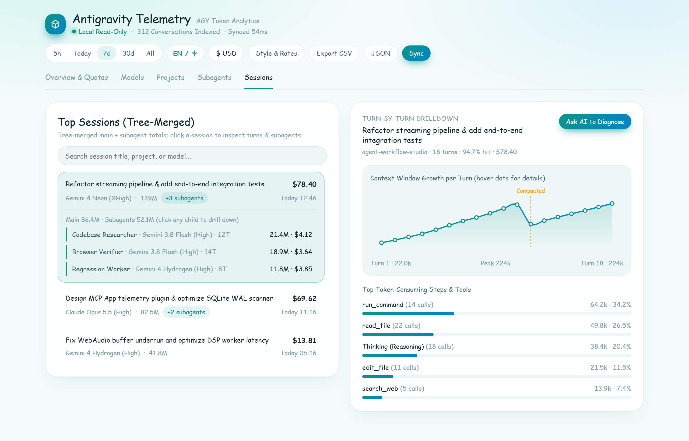
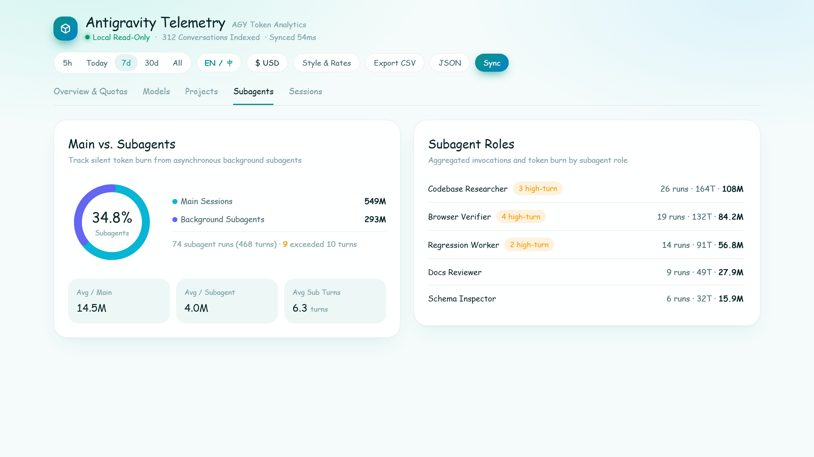
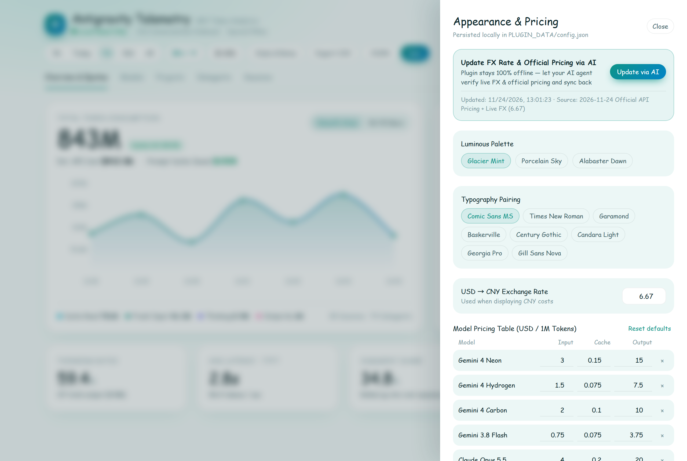

<div align="center">
  
  <h1>Antigravity Telemetry · AGY Token Analytics</h1>
  <p><strong>Luminous, 100% local read-only Token Usage, Live Quota &amp; Turn-by-Turn Diagnostics MCP App plugin for Google Antigravity 2.0 Desktop.</strong></p>

  <p>
    <a href="./README.md"><strong>English</strong></a> ·
    <a href="./README.zh-CN.md">简体中文</a>
  </p>

  <p>
    
    
    
    
  </p>
</div>

<br />

<p align="center">
  
</p>

---

## Why AGY Token Analytics?

Unlike legacy sidecar panels or editor-only extensions, **AGY Token Analytics** is built natively on Antigravity's **MCP App** architecture (`ui://` single-file HTML + `global` & `aux_pane` entrypoints + `app-only` tool isolation):

- **Three Native Entrypoints in One Plugin**
  - **Left Sidebar Full-Page Dashboard (`global`)**: Wide-screen analytics workspace.
  - **Right Auxiliary Side Pane (`aux_pane`)**: Compact companion view with one-click **"Send to AI for Diagnostics"**.
  - **In-Chat AI Assistant**: Only 4 lightweight tools are exposed to the model (`open_usage_dashboard`, `query_usage_summary`, `inspect_session_usage`, `sync_pricing_catalog`). All heavy dashboard fetches, config writes, and exports are isolated as `visibility: ["app"]` tools — **zero context window bloat**.
- **100% Local Read-Only & Millisecond Incremental Sync**
  - Zero-dependency Python 3 engine decodes `~/.gemini/antigravity/conversations/*.db` and `conversation_summaries.db` strictly in read-only mode (`mode=ro`, `PRAGMA query_only = ON`, and `immutable=1` for static databases without an active WAL so zero `-wal`/`-shm` artifacts are created).
  - Incrementally caches parsed metrics in `${PLUGIN_DATA}/usage_index.sqlite` — hundreds of conversations sync in **< 100 ms**.
- **Exact 4-Dimensional Token & Cost Telemetry**
  - Decodes actual protobuf billing metadata: **Non-cached Input / Cache Read / Thinking / Response**, **Prompt Cache hit rate & savings**, **TTFT**, and **generation throughput (tok/s)**.
  - Editable per-model pricing table (USD / 1M tokens) + **USD / CNY** toggle with custom FX rate persisted locally.
- **AI-Driven Live Pricing & FX Updates (While Keeping the Plugin 100% Offline)**
  - The plugin makes **zero** outbound network requests. Whenever you want the latest official API prices, new models, or USD→CNY spot exchange rate, click **"Let AI Update"** in the settings drawer (or ask Antigravity directly). The bundled `update-pricing` skill guides your AI agent to inspect locally observed models, verify live official pricing via web search, and write validated updates back via `sync_pricing_catalog`.
- **Live Model Pool Quotas with Graceful Degradation**
  - Reads real-time pool remaining percentages (`remainingFraction`) and reset countdowns (`resetTime`) via local Language Server RPC (`GetUserStatus` / `GetAvailableModels`), automatically deduplicating models that share the same quota pool.
  - Automatically falls back to a **local 5-hour rolling window monitor** if local RPC access is unavailable.
- **Recursive Subagent Attribution & Turn-by-Turn Drilldown**
  - Recursively rolls up multi-level subagent token burn under root conversations, renders smooth **Turn-by-Turn context curves** with automatic **Context Compaction** markers, and ranks top token-consuming tools.
- **Luminous Craft UI & Native EN/ZH Toggle**
  - Ships with **3 luminous palettes** (Glacier Mint / Porcelain Sky / Alabaster Dawn), **8 curated typography pairings**, and a one-click **`EN / 中` language switcher** in the top-right bar (auto-detects host locale on first launch and persists locally), bundled into a single self-contained HTML file with zero external CDN dependencies, plus **CSV (UTF-8 BOM) / JSON** export.

---

## Screenshots

<table>
  <tr>
    <td width="50%">
      <strong>Tree-Merged Sessions &amp; Turn-by-Turn Drilldown</strong><br />
      <sub>Expand nested subagents, spot context compaction points, rank heavy tools, and send bottlenecks to AI in one click.</sub><br /><br />
      
    </td>
    <td width="50%">
      <strong>Main vs. Subagents Attribution</strong><br />
      <sub>Monitor silent background subagent spend, average turns per subagent, and high-turn alerts by role.</sub><br /><br />
      
    </td>
  </tr>
  <tr>
    <td colspan="2">
      <strong>Appearance, Pricing Table &amp; One-Click AI Rate Sync Drawer</strong><br />
      <sub>Switch luminous palettes &amp; fonts, customize FX &amp; per-model rates, or let your AI agent fetch and sync live official pricing.</sub><br /><br />
      
    </td>
  </tr>
</table>

---

## Quick Install (Zero Build Required)

Pre-built bundles (`dist/server.cjs` and single-file `dist/ui/index.html`) are included in this repository. Only **Node.js 20+** and **Python 3.10+** are required.

### Option 1: Antigravity CLI (Recommended)

```bash
agy plugin install https://github.com/En-nagakiro/agy-token-analytics
```

### Option 2: Direct `git clone`

**Windows (PowerShell 7):**
```powershell
git clone https://github.com/En-nagakiro/agy-token-analytics.git "$HOME\.gemini\config\plugins\agy-token-analytics"
```

**macOS / Linux:**
```bash
git clone https://github.com/En-nagakiro/agy-token-analytics.git "${HOME}/.gemini/config/plugins/agy-token-analytics"
```

Antigravity 2.0 auto-discovers plugins under `~/.gemini/config/plugins/`. Open **Token 分析** directly from the left sidebar or from the `+` menu in the right auxiliary pane.

---

## Updating Exchange Rates & Official Model Pricing with AI

Open any Antigravity chat and ask:

> *"Update the USD→CNY exchange rate, supported models, and latest official API pricing for AGY Token Analytics."*

Or click **"一键让 AI 更新 / Let AI Update"** inside the settings drawer. The bundled `update-pricing` skill automatically:
1. Calls `sync_pricing_catalog(action="inspect")` to list every model observed in your local databases;
2. Searches live USD→CNY spot rates and official API pricing pages (Google Gemini, Anthropic Claude, OpenAI);
3. Writes verified per-1M-token rates (`input`, `cacheRead`, `output`) via `sync_pricing_catalog(action="update")` with strict range validation and source metadata;
4. Keeps `isReference: true` for any preview model without publicly announced pricing (never fabricates rates).

---

## Development & Build from Source

```bash
git clone https://github.com/En-nagakiro/agy-token-analytics.git
cd agy-token-analytics
npm install
```

- **Windows (PowerShell 7)** — test, build, deploy to `~/.gemini/config/plugins/agy-token-analytics`, and live-refresh the MCP server:
  ```powershell
  pwsh -NoProfile -NonInteractive -File .\scripts\deploy.ps1
  ```
- **macOS / Linux**:
  ```bash
  bash ./scripts/deploy.sh
  ```

### Architecture & Project Layout

```text
agy-token-analytics/
├── plugin.json               # Antigravity plugin manifest
├── mcp_config.json           # MCP server launch config (${PLUGIN_ROOT}, ${PLUGIN_DATA})
├── assets/logo.svg           # Plugin icon
├── docs/images/              # Sanitized documentation screenshots
├── parser/
│   ├── engine.py             # Zero-dependency Python 3 read-only incremental SQLite & protobuf engine
│   └── test_engine.py        # Unit & local DB regression tests
├── server/
│   ├── index.mjs             # Node.js MCP Server (4 model tools + 6 app-only tools + live quota client)
│   └── pricing.mjs           # Configurable pricing table, word-boundary fallback, USD/CNY & savings math
├── skills/
│   └── update-pricing/       # Built-in skill guiding the AI to verify & sync live FX & official pricing
├── web/
│   ├── index.html            # Vite single-file entry
│   ├── vite.config.mjs       # vite-plugin-singlefile config
│   └── src/                  # Self-contained MCP App frontend (@modelcontextprotocol/ext-apps)
├── dist/                     # Pre-built bundles (server.cjs + single-file ui/index.html)
└── scripts/
    ├── deploy.ps1            # Windows PowerShell 7 build & deploy script
    └── deploy.sh             # macOS / Linux build & deploy script
```

---

## Privacy & Security

- **Zero Telemetry / Zero Outbound Network**: Neither the parser, MCP server, nor single-file frontend makes any external HTTP requests or loads external CDNs. Live pricing updates run exclusively through your Antigravity conversation agent under your own permission policy.
- **Strictly Read-Only on Source DBs**: Antigravity conversation SQLite files are opened strictly with `mode=ro` + `PRAGMA query_only = ON` (and `immutable=1` when no active WAL exists). All caches, preferences, and exports live solely inside `${PLUGIN_DATA}`.

## License

[MIT](./LICENSE)
