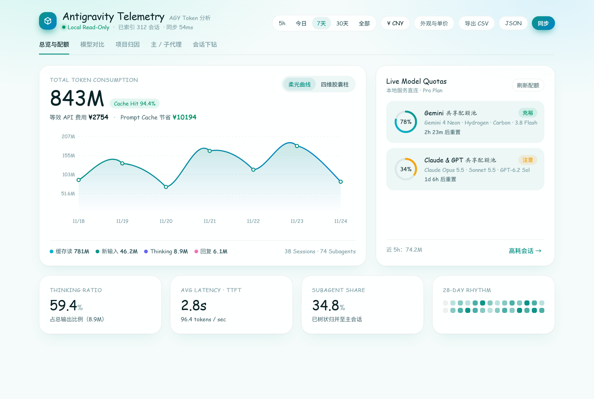
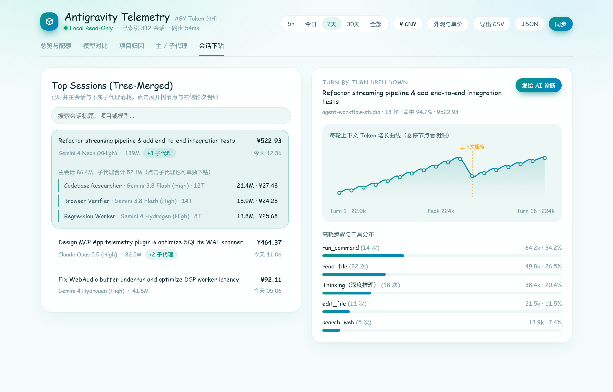
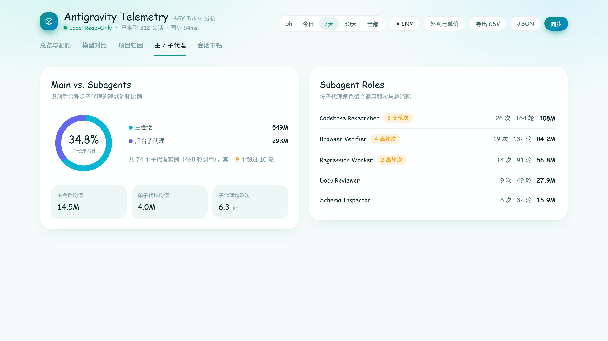
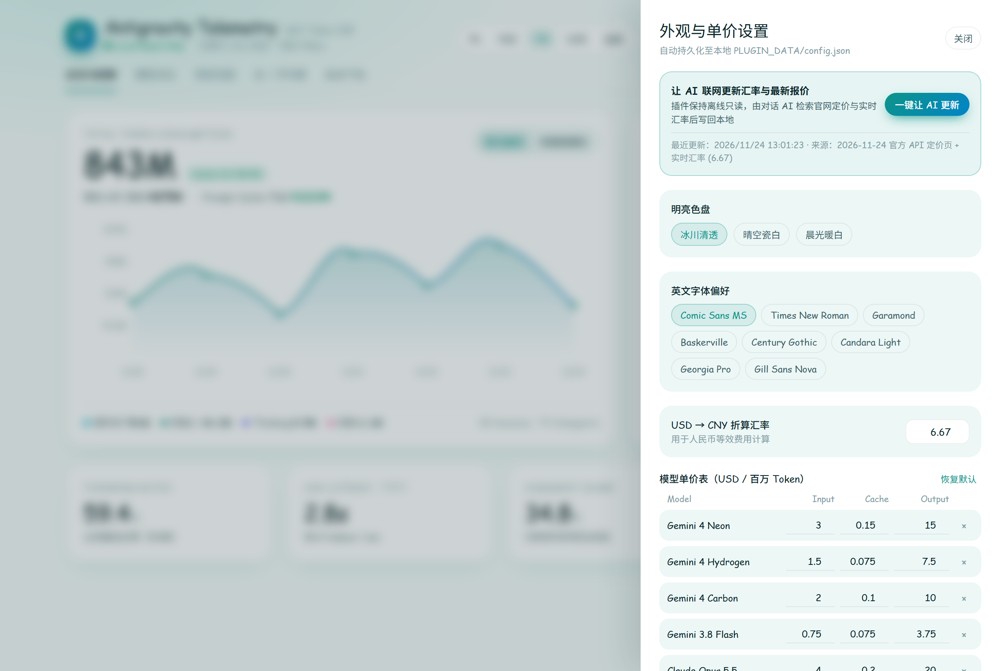

<div align="center">
  
  <h1>AGY Token 分析（agy-token-analytics）</h1>
  <p><strong>面向 Google Antigravity 2.0 桌面版的 100% 纯本地只读 Token 用量、实时模型池配额与轮次级诊断 MCP App 原生插件。</strong></p>

  <p>
    <a href="./README.md">English</a> ·
    <a href="./README.zh-CN.md"><strong>简体中文</strong></a>
  </p>

  <p>
    
    
    
    
  </p>
</div>

<br />

<p align="center">
  
</p>

---

## 核心特性

与传统的旧式 Sidecar 面板或仅限 IDE 的扩展不同，**AGY Token 分析** 基于 Antigravity 官方最新的 **MCP App** 规范构建，一套插件同时打通桌面端全部使用场景：

- **原生三入口协同，零上下文污染**
  - **左侧导航栏全页大盘（`global`）**：宽屏多栏可视化分析工作台。
  - **右侧边栏面板（`aux_pane`）**：在对话旁随时打开紧凑视图，支持一键 **「发给 AI 诊断」** 优化高消耗会话。
  - **对话内直接查账**：仅对模型暴露 4 个极简工具（`open_usage_dashboard`、`query_usage_summary`、`inspect_session_usage`、`sync_pricing_catalog`），所有重型拉数、单价保存与报表导出全部隔离为 `visibility: ["app"]` 内部工具，**不占对话上下文窗口**。
- **100% 本地只读 & 毫秒级增量索引**
  - 零第三方依赖的 Python 3 解析引擎严格以只读模式（`mode=ro` + `PRAGMA query_only = ON`）解析 `~/.gemini/antigravity/conversations/*.db` 与 `conversation_summaries.db`；对无活跃 WAL 的历史静态库自动使用 `immutable=1`，**零 `-wal`/`-shm` 副产物污染**。
  - 解析结果按文件指纹增量缓存至 `${PLUGIN_DATA}/usage_index.sqlite`，数百个会话二次打开仅需 **数十毫秒**。
- **精确四维 Token 拆分与等效 API 费用**
  - 直接解码 Antigravity 底层 protobuf 真实计费记录，精确拆分 **非缓存输入 / 缓存读取 / Thinking 推理 / 正文回复**，自动计算 **Prompt Cache 命中率与节省金额**、**平均首字耗时（TTFT）** 与 **生成吞吐速度（tok/s）**。
  - 支持 **USD / CNY 一键切换** 与本地持久化自定义单价表。
- **大模型联网自动更新汇率、受支持模型与官方报价**
  - 插件本身坚持 **100% 离线、零外网请求**；当需要最新汇率、新发布模型或官方最新 API 报价时，点击抽屉里的 **「一键让 AI 更新」**（或直接在对话中让 AI 更新），内置 `update-pricing` Skill 会引导大模型先检查本机历史用过的模型，再联网核实实时汇率与官方定价页，并经严格范围校验后通过 `sync_pricing_catalog` 安全写回本地配置。
- **实时模型池配额监控（带优雅降级）**
  - 优先直连本机 Language Server 只读接口（`GetUserStatus` / `GetAvailableModels`），自动合并共享同一额度的模型池，用渐变圆弧仪表盘实时展示剩余百分比与重置倒计时。
  - 若运行环境未注入本地配额服务地址，自动无感降级为 **基于本地数据库的近 5 小时滚动消耗统计**。
- **多级子代理树状归并 & 单会话轮次下钻**
  - 递归归并嵌套子代理消耗至根主会话，展开树节点可单独下钻任意子代理；单会话面板绘制 **每轮上下文 Token 平滑曲线**，自动标注 **「上下文压缩」** 节点并统计高耗步骤/工具分布。
- **干净明亮的高定外观与报表导出**
  - 内置 **3 套干净明亮色盘**（冰川清透 / 晴空瓷白 / 晨光暖白）× **8 款精选字体搭配**，全量打包进单个零外链 HTML（严格通过 MCP App CSP），支持 **CSV（带 UTF-8 BOM）/ JSON** 报表导出。

---

## 界面预览

<table>
  <tr>
    <td width="50%">
      <strong>会话树状归并 &amp; 单会话轮次下钻</strong><br />
      <sub>主会话自动汇总下属子代理消耗，展开查看子代理明细、每轮上下文压缩节点与高耗工具排行，右侧栏可一键发给 AI 诊断。</sub><br /><br />
      
    </td>
    <td width="50%">
      <strong>主会话 vs. 后台子代理拆解</strong><br />
      <sub>识别后台异步子代理的静默消耗比例、单实例均值、平均轮次及超 10 轮高耗角色提醒。</sub><br /><br />
      
    </td>
  </tr>
  <tr>
    <td colspan="2">
      <strong>外观偏好、自定义单价表 &amp; AI 联网更新汇率/报价抽屉</strong><br />
      <sub>自由切换明亮色盘与英文字体、手工调整汇率与单价，或点击「一键让 AI 更新」自动同步官网最新报价。</sub><br /><br />
      
    </td>
  </tr>
</table>

---

## 快速安装（免构建开箱即用）

本仓库已附带预编译产物（`dist/server.cjs` 与单文件 `dist/ui/index.html`），只需本机已安装 **Node.js 20+** 与 **Python 3.10+** 即可直接运行。

### 方式一：通过 Antigravity CLI 安装（推荐）

```bash
agy plugin install https://github.com/<your-username>/agy-token-analytics
```

### 方式二：直接 `git clone` 到插件目录

**Windows（PowerShell 7）：**
```powershell
git clone https://github.com/<your-username>/agy-token-analytics.git "$HOME\.gemini\config\plugins\agy-token-analytics"
```

**macOS / Linux：**
```bash
git clone https://github.com/<your-username>/agy-token-analytics.git "${HOME}/.gemini/config/plugins/agy-token-analytics"
```

Antigravity 2.0 会自动发现 `~/.gemini/config/plugins/` 下的新插件。随后即可从左侧导航栏直接点击 **「Token 分析」**，或在对话右侧边栏点 **`+`** 打开。

---

## 让 AI 自动更新汇率与官方最新报价

在任意 Antigravity 对话中直接输入：

> 「帮我联网更新 AGY Token 分析的 USD→CNY 实时汇率、受支持模型和最新官方 API 报价」

或在插件的 **「外观与单价」** 抽屉中点击 **「一键让 AI 更新」**。内置 `update-pricing` Skill 会自动完成：
1. 调用 `sync_pricing_catalog(action="inspect")` 盘点本机历史上所有实际用过的模型与未精确匹配项；
2. 联网核实当日 USD→CNY 实时汇率，以及 Google Gemini / Anthropic Claude / OpenAI 官方定价页的每百万 Token 报价（`input` / `cacheRead` / `output`）；
3. 通过 `sync_pricing_catalog(action="update")` 带合法性校验写回本地配置，并保留尚无官方公开报价模型的 `isReference: true` 标记，杜绝编造价格；
4. 完成后在大盘右上角点 **「同步」** 即可按最新汇率和官方报价重算全盘费用。

---

## 源码开发与本地构建

```bash
git clone https://github.com/<your-username>/agy-token-analytics.git
cd agy-token-analytics
npm install
```

- **Windows（PowerShell 7）**——运行测试、构建、部署到本机插件目录并热刷新 MCP Server：
  ```powershell
  pwsh -NoProfile -NonInteractive -File .\scripts\deploy.ps1
  ```
- **macOS / Linux**：
  ```bash
  bash ./scripts/deploy.sh
  ```

### 目录结构

```text
agy-token-analytics/
├── plugin.json               # Antigravity 插件清单
├── mcp_config.json           # MCP Server 启动配置（${PLUGIN_ROOT}, ${PLUGIN_DATA}）
├── assets/logo.svg           # 插件图标
├── docs/images/              # 脱敏高清文档截图
├── parser/
│   ├── engine.py             # Python 3 零第三方依赖只读增量 SQLite & protobuf 解析引擎
│   └── test_engine.py        # 单元测试与本地数据库回归校验
├── server/
│   ├── index.mjs             # Node.js MCP Server（4 个模型工具 + 6 个 app-only 工具 + 实时配额客户端）
│   └── pricing.mjs           # 可编辑单价表、词边界系列兜底匹配、USD/CNY 与缓存节省计算引擎
├── skills/
│   └── update-pricing/       # 内置 Skill：引导大模型联网核实并更新汇率、受支持模型与官方报价
├── web/
│   ├── index.html            # Vite 单文件前端入口
│   ├── vite.config.mjs       # vite-plugin-singlefile 打包配置
│   └── src/                  # 零外链 MCP App 前端源码（@modelcontextprotocol/ext-apps）
├── dist/                     # 预编译自包含产物（server.cjs + 单文件 ui/index.html）
└── scripts/
    ├── deploy.ps1            # Windows PowerShell 7 一键构建与部署脚本
    └── deploy.sh             # macOS / Linux 一键构建与部署脚本
```

---

## 隐私与安全承诺

- **零遥测、零外联**：解析器、MCP Server 与单文件前端均不发起任何外部网络请求、不加载任何第三方 CDN。联网更新报价完全通过用户自己的对话 AI 代理在用户授权下完成。
- **对源数据库严格只读**：所有 Antigravity 会话库均通过 `mode=ro` + `PRAGMA query_only = ON` 打开，全部增量缓存、自定义单价和导出报表仅保存在插件专属 `${PLUGIN_DATA}` 目录。

## 开源协议

[MIT](./LICENSE)
